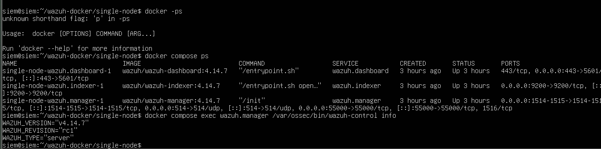
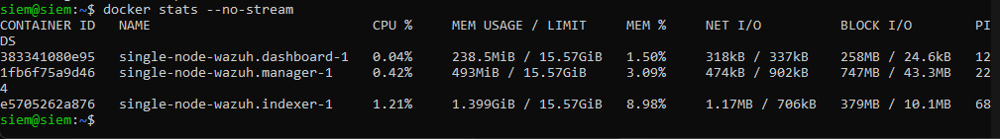

# Mini-SOC in a box: Week 1

Week 1 of a 12-week Blue Team capstone. LabShop is a small online shop with one web server and one staff PC and no security monitoring. My job this week: build an isolated lab and deploy Wazuh so I can see what the machines are doing.

## Overview

- **Platform:** Wazuh **4.14.7** (single-node, Docker Compose) on `siem-host`
- **Agents:** `ubuntu-web` (Linux, nginx) and `win-client` (Windows 10 + Sysmon)
- **Hypervisor:** VMware Workstation, host-only network VMnet4 (192.168.56.0/24)
- **Diagram and address table:** see [`architecture/`](architecture/)
- **Evidence (screenshots):** see [`evidence/`](evidence/)
- **Journal:** see [`journal.md`](journal.md)

## Start the lab (in this order)

1. Power on **siem-host** and log in.
2. Start the Wazuh stack:
   ```
   cd ~/wazuh-docker/single-node
   docker compose start
   docker compose ps          # all 3 containers must show Up
   ```
3. Wait 2-3 minutes, then open `https://192.168.56.10` from the Dell and log in as `admin`.
4. Power on **ubuntu-web**.
5. Power on **win-client**.
6. In the dashboard open Agents: both agents must be **Active**.

## Stop the lab (reverse order)

1. Shut down **win-client**.
2. Shut down **ubuntu-web**: `sudo shutdown now`
3. On siem-host: `docker compose stop`
4. Shut down **siem-host**: `sudo shutdown now`

Never run `docker compose down -v`: `-v` deletes the volumes and with them all alerts and agent data.

## Wazuh platform (W1)

- Version: **Wazuh 4.14.7**, checked with the image tags (`wazuh/wazuh-manager:4.14.7`, `wazuh-indexer:4.14.7`, `wazuh-dashboard:4.14.7`)
- Containers: `wazuh.manager`, `wazuh.indexer`, `wazuh.dashboard`, all Up



This screenshot proves all three containers run and shows the 4.14.7 image tags.

## Verification events (V1)

I caused five events on purpose and found each one in the dashboard (Threat Hunting > Events).

| # | Event | Agent | Rule description | Level | Screenshot |
|---|---|---|---|---|---|
| 1 | Failed SSH login | ubuntu-web | sshd: Attempt to login using a non-existent user (rule 5710) | 5 | `evidence/07-event1-ssh.png` |
| 2 | Command run with sudo | ubuntu-web | Successful sudo to ROOT executed. (rule 5402) | 3 | `evidence/08-event2-sudo.png` |
| 3 | New local user created | ubuntu-web | New user added to the system. (rule 5902) | 8 | `evidence/09-event3-adduser.png` |
| 4 | Program started on Windows (Sysmon) | win-client | Discovery activity executed | 3 | `evidence/10-event4-sysmon.png` |
| 5 | Failed Windows logon | win-client | Logon Failure - Unknown user or bad password (rule 60122) | 5 | `evidence/11-event5-winlogon.png` |

## Event path (V2)

Example: `sudo ls /root` on ubuntu-web.

1. Linux writes the sudo command to `/var/log/auth.log`.
2. The Wazuh agent (logcollector module) reads the new line. This needs a `<localfile>` entry for `auth.log` in the agent's `ossec.conf`.
3. The agent sends the line, encrypted, to the manager on TCP 1514. Port 1515 is only used when the agent enrolls.
4. The manager decodes the line and matches it against its rules. Here it matches rule 5402, level 3.
5. The manager writes the alert to `alerts.json`.
6. Filebeat (inside the manager container) ships the alert to the indexer over HTTPS on port 9200.
7. The indexer stores the alert in the `wazuh-alerts-*` index.
8. The dashboard queries the indexer and shows the alert in the Events view.

Debugging note: after I changed the admin password, agents were Active and alerts were written to `alerts.json`, but the dashboard stayed empty. `filebeat test output` returned `401 Unauthorized`, which placed the break between step 5 and step 7: the manager was still using the old indexer password.

## Idle memory use (W5)

Measured with `docker stats --no-stream` while the lab was idle (no events being generated, agents connected).

| Container | Memory usage | % of limit | CPU |
|---|---|---|---|
| wazuh.indexer | 1.355 GiB | 35.88% | 1.18% |
| wazuh.manager | 407.4 MiB | 10.53% | 1.05% |
| wazuh.dashboard | 207.9 MiB | 5.37% | 0.30% |




This screenshot proves the idle memory values in the table.

## Security notes

- No password, key or certificate is stored in this repository. `.gitignore` excludes `.env`, `*.pem`, `*.key`, `*.crt`, `certs/`, `secrets/` and the `wazuh-docker/` folder.
- The default Wazuh admin password was changed. The new password is kept in a password manager only.
- Only `siem-host` has a permanent NAT adapter. The endpoints get NAT only while installing software, then it is removed.

## Notes

- Windows evaluation image expires on: 89 days
