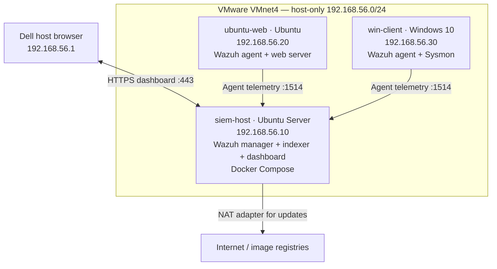

# Week 1 lab architecture

This diagram documents the intended logical traffic flow. Confirm interface names, addresses, and VM resources against the running VMware configuration before submission.

## Network and security notes

- The three VMs share the isolated host-only network.
- Only `siem-host` should retain a permanent NAT adapter.
- The endpoints may use temporary NAT during software installation, then that adapter should be removed.
- Wazuh agent enrollment commonly uses TCP 1515; normal agent event traffic commonly uses TCP 1514. Verify actual listening ports and firewall rules in the lab.
- The diagram describes the target design, not proof that the current services and routes are healthy.
- See [addresses.md](addresses.md) for the recorded address and resource table.
